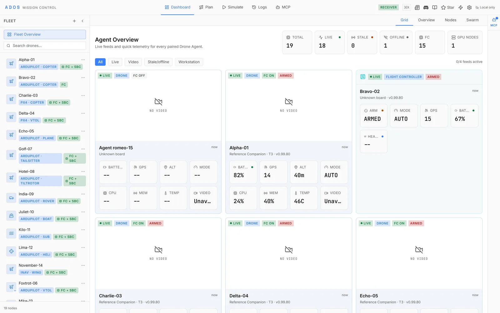
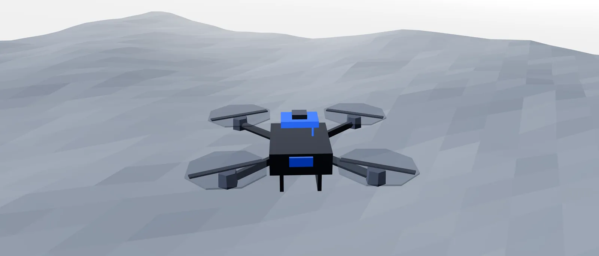
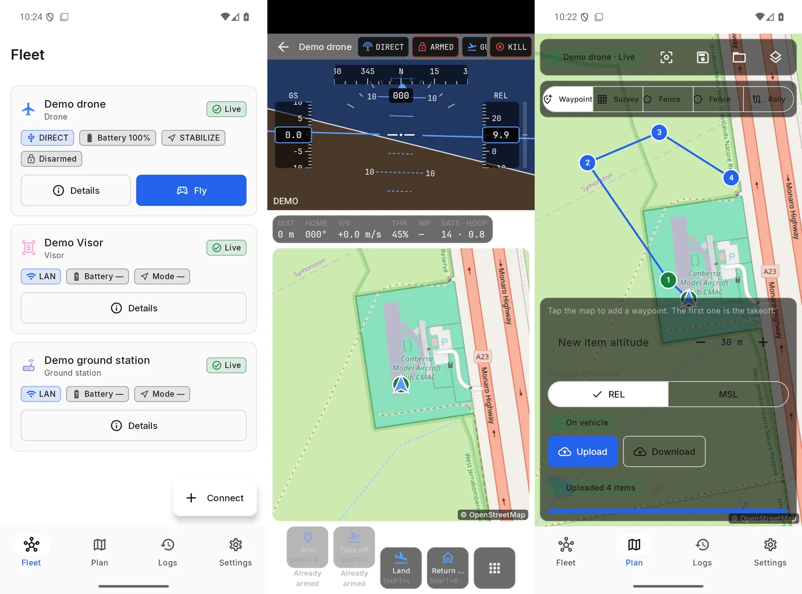
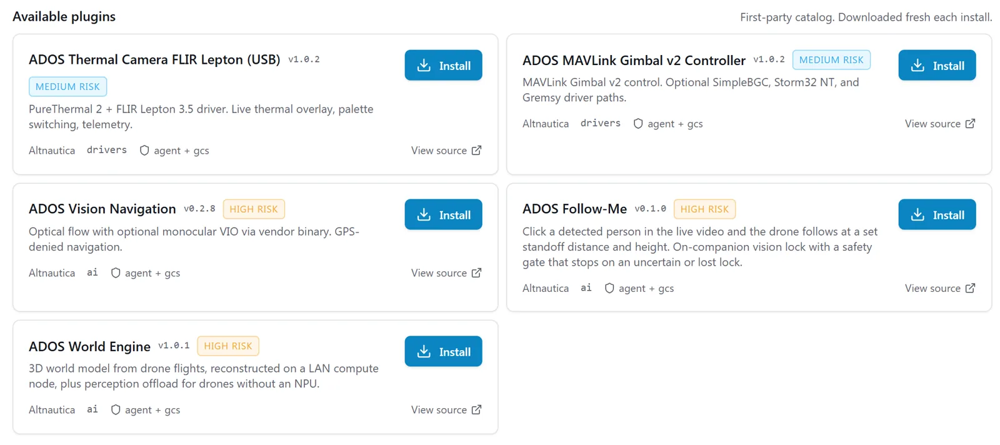
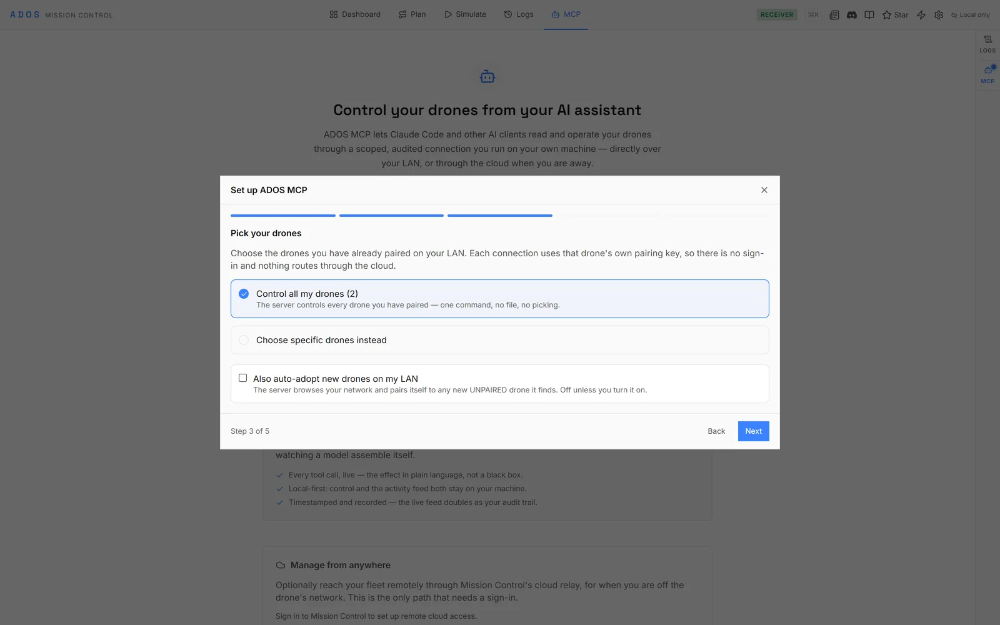
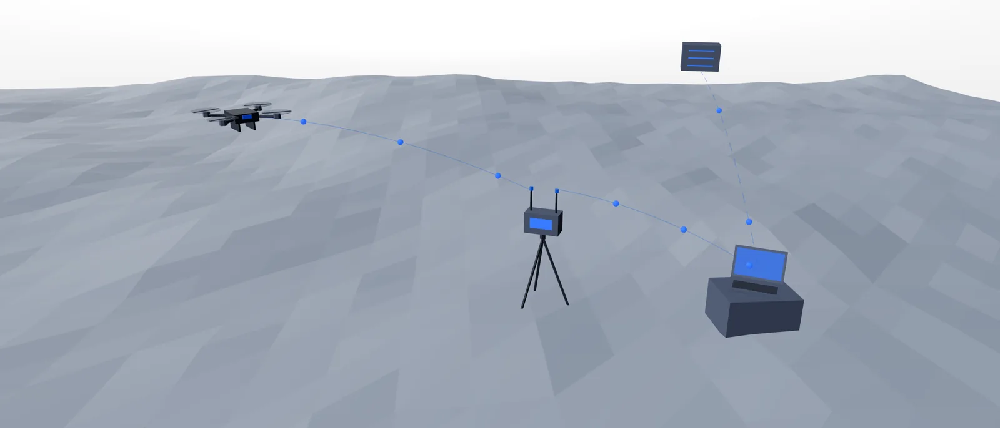
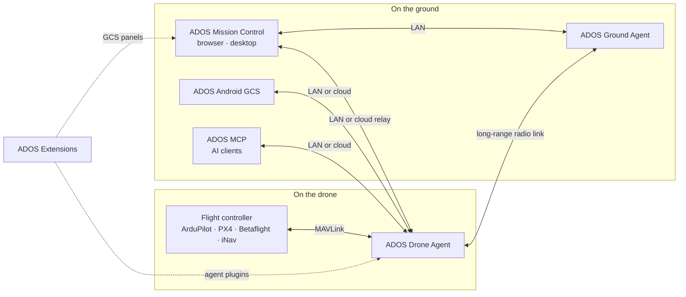

  <a href="https://altnautica.com">
    <picture>
      <source media="(prefers-color-scheme: dark)" srcset="./assets/brand/altnautica-wordmark-dark.svg">
      
    </picture>
  </a>

<h3 align="center">The Open Compute Layer for Drones</h3>

  
  
  
  
  

https://github.com/user-attachments/assets/09f265f4-b692-468a-a170-2be2d8525ae7

**ADOS** is an open-source platform for software-defined drones. The Drone Agent turns a companion computer into the drone's onboard brain for the radio link, video, vision, swarm and extensions, and you run it from Mission Control in the browser or on the desktop, from Android, or through AI clients over MCP. It works with ArduPilot, PX4, Betaflight and iNav.

Features such as World Engine (beta), visual-inertial and LiDAR SLAM poses and GPS-denied navigation grow with every release. ADOS is built as a base for smart agriculture, indoor operations and logistics in GPS-denied warehouses, with extensions, a Rust SDK and published crates for anyone who wants to build on it.

## Projects

<!-- ados-family:projects -->
<table>
<tr>
<td width="50%" valign="top"><a href="https://github.com/altnautica/ADOSMissionControl"><picture><source media="(prefers-color-scheme: dark)" srcset="./assets/cards/mission-control-dark.webp"></picture></a><h3><a href="https://github.com/altnautica/ADOSMissionControl">ADOS Mission Control</a></h3>
Ground control station: FC setup, mission planning, flight, 3D simulation, fleet.

Runs on: Browser, desktop (Electron)

  
</td>
<td width="50%" valign="top"><a href="https://github.com/altnautica/ADOSDroneAgent"><picture><source media="(prefers-color-scheme: dark)" srcset="./assets/cards/drone-agent-dark.webp"></picture></a><h3><a href="https://github.com/altnautica/ADOSDroneAgent">ADOS Drone Agent</a></h3>
Onboard agent: MAVLink routing, HD video, long-range radio link, plugins, remote control.

Runs on: Companion computer on the drone, or a ground node

  
</td>
</tr>
<tr>
<td width="50%" valign="top"><a href="https://github.com/altnautica/ADOSAndroidGCS"><picture><source media="(prefers-color-scheme: dark)" srcset="./assets/cards/android-gcs-dark.webp"></picture></a><h3><a href="https://github.com/altnautica/ADOSAndroidGCS">ADOS Android GCS</a></h3>
Native ground control app for agents on the LAN, direct flight controllers and the cloud.

Runs on: Android phones and tablets

  
</td>
<td width="50%" valign="top"><a href="https://github.com/altnautica/ADOSExtensions"><picture><source media="(prefers-color-scheme: dark)" srcset="./assets/cards/extensions-dark.webp"></picture></a><h3><a href="https://github.com/altnautica/ADOSExtensions">ADOS Extensions</a></h3>
First-party signed plugins, each with an agent half and a GCS half.

Runs on: Drone Agent and Mission Control

  
</td>
</tr>
<tr>
<td width="50%" valign="top"><a href="https://github.com/altnautica/ADOS-MCP"><picture><source media="(prefers-color-scheme: dark)" srcset="./assets/cards/mcp-dark.webp"></picture></a><h3><a href="https://github.com/altnautica/ADOS-MCP">ADOS MCP</a></h3>
Model Context Protocol server that lets AI clients operate ADOS drones under scopes and a safety gate.

Runs on: Your machine

  
</td>
<td width="50%" valign="top"><a href="https://github.com/altnautica/Documentation"><picture><source media="(prefers-color-scheme: dark)" srcset="./assets/cards/docs-dark.webp"></picture></a><h3><a href="https://github.com/altnautica/Documentation">Documentation</a></h3>
Public docs for every ADOS product.

Runs on: docs.altnautica.com

  
</td>
</tr>
</table>
<!-- /ados-family:projects -->

## How ADOS fits together

ADOS Ground Agent is the Drone Agent running its ground-station profile.

## Rust crates

Reusable libraries from the ADOS Drone Agent, published on crates.io under MIT OR Apache-2.0 (one crate is MIT only). Versioning and licences: [crates index](https://github.com/altnautica/ADOSDroneAgent/tree/main/crates#published-crates).

<!-- ados-family:crates -->
**Platform (versioned with the ADOS Drone Agent)**

| Crate | What it does | Docs |
|---|---|---|
| [`ados-protocol`](https://crates.io/crates/ados-protocol) | Wire contracts of the ADOS Drone Agent: IPC framing, plugin RPC envelope, capability tokens and the vision frame bus. | [docs.rs](https://docs.rs/ados-protocol) |
| [`ados-sdk`](https://crates.io/crates/ados-sdk) | Write Rust plugins for the ADOS Drone Agent: IPC client, plugin context, driver traits and lifecycle runner. | [docs.rs](https://docs.rs/ados-sdk) |
| [`ados-vision`](https://crates.io/crates/ados-vision) | Single-object visual tracker: Kalman motion model, appearance re-identification and YOLOv8 head decoding. | [docs.rs](https://docs.rs/ados-vision) |
| [`ados-gpio`](https://crates.io/crates/ados-gpio) | Drive status buzzers and LEDs on Linux GPIO lines, with bounded software-PWM beep patterns. | [docs.rs](https://docs.rs/ados-gpio) |
| [`ados-hal-probe`](https://crates.io/crates/ados-hal-probe) | Find out what a board's hardware can really do by probing it, plus bundled board profiles. | [docs.rs](https://docs.rs/ados-hal-probe) |

**Standalone**

| Crate | What it does | Docs |
|---|---|---|
| [`ados-sensorhub`](https://crates.io/crates/ados-sensorhub) | Sensor hub wire protocol: COBS framing, CRC-16 and fixed-layout IMU, baro, mag and GNSS packets. no_std. | [docs.rs](https://docs.rs/ados-sensorhub) |
| [`ados-offload`](https://crates.io/crates/ados-offload) | Choose where perception runs (onboard, offloaded or hybrid) and hold the vehicle when results go stale. | [docs.rs](https://docs.rs/ados-offload) |
| [`ados-macpin`](https://crates.io/crates/ados-macpin) | Stable MAC addresses for Linux network adapters that randomize theirs every boot. | [docs.rs](https://docs.rs/ados-macpin) |
| [`ados-lora`](https://crates.io/crates/ados-lora) | LoRa transmit governor with cited regional band plans, duty cycle, dwell time and airtime accounting. | [docs.rs](https://docs.rs/ados-lora) |
| [`ados-crsf-codec`](https://crates.io/crates/ados-crsf-codec) | no_std CRSF / ExpressLRS codec for RC channels, telemetry and parameter frames. | [docs.rs](https://docs.rs/ados-crsf-codec) |
| [`ados-positioning`](https://crates.io/crates/ados-positioning) | Split mixed UBX, NMEA and RTCM3 GNSS streams, configure u-blox receivers and run an RTK base survey-in. | [docs.rs](https://docs.rs/ados-positioning) |
| [`ados-rtcm`](https://crates.io/crates/ados-rtcm) | RTCM3 framing, CRC-24Q and MAVLink GPS_RTCM_DATA fragmentation for RTK corrections. | [docs.rs](https://docs.rs/ados-rtcm) |
| [`ados-clock`](https://crates.io/crates/ados-clock) | Map remote clocks onto the host clock: least-squares and envelope fits, TIMESYNC and a chrony sink. | [docs.rs](https://docs.rs/ados-clock) |
| [`ados-swarm`](https://crates.io/crates/ados-swarm) | Swarm control laws: separation, flocking, formations, CBBA task allocation and a point-mass simulator. | [docs.rs](https://docs.rs/ados-swarm) |
| [`ados-mavlink-tunnel`](https://crates.io/crates/ados-mavlink-tunnel) | Send large messages over MAVLink TUNNEL frames with chunking and bounded reassembly. | [docs.rs](https://docs.rs/ados-mavlink-tunnel) |
| [`ados-display-driver`](https://crates.io/crates/ados-display-driver) | Small-display output on Linux: SSD1306/SH1106 OLED over I2C, pixel packers and a framebuffer writer. | [docs.rs](https://docs.rs/ados-display-driver) |
| [`ados-hmi`](https://crates.io/crates/ados-hmi) | Front-panel input: touchscreen calibration and gestures, button presses and rotary encoders. | [docs.rs](https://docs.rs/ados-hmi) |
<!-- /ados-family:crates -->

## Get involved

- **Fly it:** [install the Drone Agent](https://docs.altnautica.com/drone-agent/overview) on a companion computer and open [Mission Control](https://command.altnautica.com).
- **Build on it:** write an agent plugin with the [Rust SDK](https://docs.rs/ados-sdk) or follow the [extension guide](https://docs.altnautica.com/developers/overview).
- **Talk to us:** [Discord](https://discord.gg/uxbvuD4d5q), or open an issue on the repo you are using.
- **Contribute:** pull requests are welcome; each README has a Contributing section.

ADOS applications are licensed GPL-3.0-or-later; the Rust library crates are MIT OR Apache-2.0.
